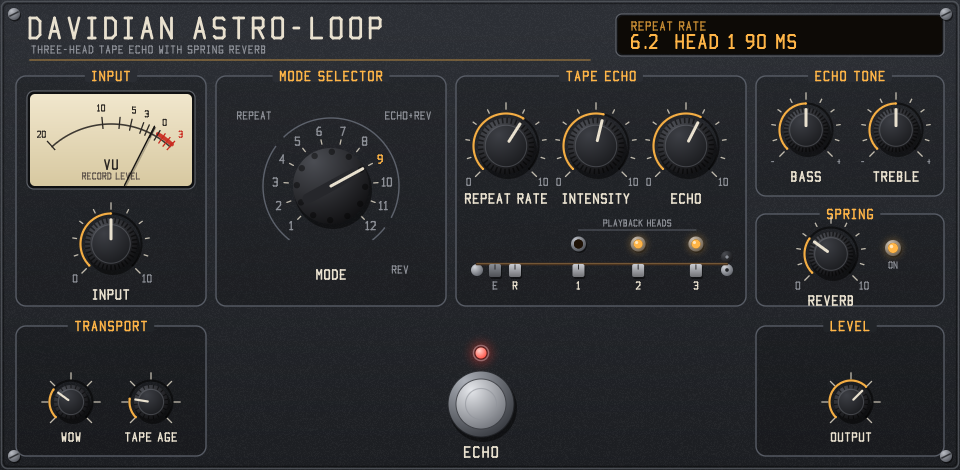

# Davidian Astro-Loop

A model of a classic 1970s three-head tape echo with spring reverb, as an LV2, VST3 and Audio Unit plugin. It follows the unit's 1978 service notes: the block diagram, the echo board circuit, the twelve-position mode selector table and the reference data. Figures the service notes leave out were checked against published measurements; anything still unverified is listed under [Estimates](#estimates).

**A close model, not an exact copy.** It is built from the service notes and published figures, not sampled or measured from a unit. It has not been compared side by side with real hardware, so expect it to sound close to the original rather than identical.



Stereo in and out with no latency. The tape and springs are mono, as on the unit: the two inputs are summed for the echo and reverb, the dry signal keeps its stereo image, and the wet signal goes to both outputs. Every format is built from the same code, shows the same GUI and sounds identical (the VST3 test compares them sample for sample). GPL-3.0-or-later.

| Format | Windows | macOS | Linux |
|---|---|---|---|
| LV2 | built and tested | builds with CMake (untested) | builds with CMake (untested) |
| VST3 | built and tested | | |
| Audio Unit (AUv2) | | source written, **not yet compiled** | |

The LV2 URI is `urn:davidian:astro-loop`, the bundle is `astro_loop.lv2`, and the VST3 is `Davidian Astro-Loop.vst3` (Delay category). The Audio Unit is listed under **Davidian** as **Astro-Loop** (manufacturer `Dvdn`, subtype `Astl`).

## Controls

| Panel | Control | Unit part / behaviour |
|---|---|---|
| Input | Input | Instrument volume (VR3). Sets the record level and the dry level together, as on the unit. 5 is unity; an input peaking at -12 dBFS then records at 0 VU |
| Input | VU meter | Record level, average-responding with 300 ms ballistics, -20 to +3 VU |
| Mode Selector | 1–12 | The service notes' table (below). Click a number, drag, or use the wheel |
| Tape Echo | Repeat Rate | Capstan motor speed (VR4), 15.6 to 40 cm/s; the readout shows head 1's echo time. The motor takes about a second or two to follow, so turning it gives the pitch-bending glide |
| Tape Echo | Intensity | Regeneration (VR5). With one head, repeats run away from about 7 |
| Tape Echo | Echo | Echo volume (VR6) |
| Echo Tone | Bass, Treble | ±10 dB at 100 Hz and 5 kHz, on the echo only (not the dry or the reverb) |
| Spring | Reverb | Reverb volume (VR9). The ON lamp shows whether the mode selector has the reverb in |
| Transport | Wow | Wow and flutter, 0 to 10 (not on the unit; a worn transport has more) |
| Transport | Tape Age | Not on the unit: darker repeats, more hiss and more flutter as the tape and heads wear |
| (footswitch) | Echo | Echo on/cancel. Cancel stops new sound reaching the record head and lets the repeats already on the tape die away |
| Level | Output | Not on the unit: -24 to +12 dB |
| (host) | Enabled / bypass | 20 ms crossfade to the dry input |

The three amber lamps over the playback heads in the tape drawing show which heads the mode selector has switched in.

### Mode selector (from the service notes)

| Position | 1 | 2 | 3 | 4 | 5 | 6 | 7 | 8 | 9 | 10 | 11 | 12 |
|---|---|---|---|---|---|---|---|---|---|---|---|---|
| Head 1 | • | | | | • | | | • | | • | • | |
| Head 2 | | • | | • | | • | | • | • | | • | |
| Head 3 | | | • | • | | | • | | • | • | • | |
| Reverb | | | | | • | • | • | • | • | • | • | • |

## How it is modelled

- **Tape transport** (`src/tape.h`): an endless loop with a record head and three playback heads. The model stores the tape position of every recorded sample, and each playback head reads whatever was recorded a fixed distance upstream. Speed changes therefore glide in pitch the way tape does, and wow and flutter come out at the right size: the pitch moves by the difference between record and playback speed, not by the change in delay.
- **Motor** (`src/engine.c`): the speed follows the repeat rate with measured time constants, 1.89 s when slowing and 1.07 s when speeding up. Wow is mostly random drift below 1 Hz, plus once-per-turn components from the pinch roller and capstan.
- **Record and playback chain**: input volume, then the intensity feedback is added at the recording pre-amp input. Pre-emphasis follows, then tape saturation with an error-function curve, so loud treble compresses first. On playback come de-emphasis, a speed-dependent high-frequency loss (about 7 kHz at top speed, 3.5 kHz at the slowest), a small head bump and the coupling high-pass. Intensity taps the playback pre-amp ahead of the echo volume and tone controls, as in the circuit, so those two don't change the regeneration.
- **Spring reverb** (`src/spring.h`): three springs, as in the unit's "Z" tank. Each spring is a delay loop around a chain of allpass filters, which gives the falling chirps. The drive IC clips gently. The reverb is fed from the recording pre-amp input, so it reverberates the repeats as well as the input. That follows the block diagram, but no published description confirms it.
- **Tone**: bass and treble shelves set to hit the service notes' ±10 dB at 100 Hz and 5 kHz exactly, either side of the 750 Hz crossover measured for the unit's Baxandall stage.

### Checked against the service notes and published figures

| Item | Model | Source |
|---|---|---|
| Echo time, head 1 | 69–177 ms | Published measurements: 69–177 ms (two commercial emulations' manuals) |
| Heads 2 and 3 | 1.94× and 2.85× head 1 (134–343 ms, 197–504 ms) | Same: 1.94× and 2.85×, "500 ms max at head 3" |
| Tape speed | 15.6–40 cm/s | Service notes: "12cm – 40cm/sec (approx)" |
| Mode selector | 12 positions, all checked by `test_dsp` | Service notes' table |
| Bass / treble | ±10.0 dB at 100 Hz / 5 kHz | Service notes: ±10 dB at 100 Hz / 5 kHz |
| Intensity | Repeats run away from 7.2 (one head) | Service notes' intensity adjustment drawing |
| Motor ballistics | τ 1.89 s slowing, 1.07 s speeding up | Downing and Terjesen, University of Rochester, 2016 (measured on a unit) |
| Wow spectrum, saturation shape | Drift below 1 Hz; error-function curve | Same paper |

The service notes don't give the head spacing, so the speed range was worked out from the published echo times and the notes' 40 cm/s top speed. The slowest speed that gives 177 ms at head 1 is 15.6 cm/s, inside the notes' approximate range.

### Estimates

No published figure was found for these:

- **Spring tank:** round-trip delays 33, 37 and 41 ms, a 2.4 s decay, and the allpass dispersion and band limits.
- **Echo cancel footswitch:** the service notes show it wired to the power supply board but don't say what it switches. The plugin mutes the record input and lets the repeats decay. If the hardware cuts the repeats instead, this is the part to change.
- **Record level and saturation point; pre-emphasis** (+8 dB above 2.5 kHz); **playback high-frequency loss and head bump; wow and flutter depths** (up to about 0.35% drift at full).
- **Pot tapers:** input, echo and reverb volumes are audio taper, and the repeat rate is linear in speed.
- **Hiss** at -84 dBFS on new tape, rising to -60 dBFS with Tape Age.

### Simplifications

- The unit's two mic inputs, the instrument ECHO/NORMAL switch, the output level selector and the bias oscillator are left out. The input volume stands for the instrument channel.
- Transistor stages are linear apart from the tape, the reverb drive IC and the output buffer's limit at about +12 dBFS.

## Build

Plain C11 for the plugin, GUI and LV2 (no LV2 SDK needed); C++17 for the VST3 and Audio Unit wrappers. CMake downloads the Steinberg VST3 SDK 3.8.1 (MIT) and Apple's AudioUnitSDK 1.2.0 (Apache 2.0) while configuring.

| Source | What it is |
|---|---|
| `src/tape.h`, `src/spring.h`, `src/dsp.h` | Tape transport, spring tank, filters |
| `src/engine.c`, `src/engine.h` | The signal path and controls, behind a small C API every format uses |
| `src/params.h`, `src/ports.h` | Parameters and the LV2 port numbers they match; the mode selector table |
| `src/plugin.c`, `src/ui/ui_lv2.c` | LV2 plugin and GUI |
| `src/vst3/`, `src/au/` | VST3 and Audio Unit wrappers |
| `src/ui/panel.h`, `src/ui/view.c` | The panel and its window layer (Win32, Cocoa, X11) |
| `src/ui/canvas.h`, `src/ui/font.h`, `src/ui/style.h` | Davidian GUI house style, shared with the Bi-Lumen |

### Windows

`build.bat` builds `build\astro_loop.lv2` and the test programs with Visual Studio's C compiler. For the VST3 too, use CMake (3.25 or later):

```bash
cmake -S . -B build-cmake -A x64
```

```bash
cmake --build build-cmake --config Release
```

```bash
ctest --test-dir build-cmake -C Release
```

The VST3 lands in `build-cmake\VST3\Release\Davidian Astro-Loop.vst3`. Steinberg's validator runs after every build.

### macOS and Linux

```bash
cmake -S . -B build-cmake -DCMAKE_BUILD_TYPE=Release && cmake --build build-cmake && ctest --test-dir build-cmake
```

On macOS this also builds `build-cmake/AU/Davidian Astro-Loop.component` and runs `au_check`, which compares it with the LV2 build. Run `auval -v aufx Astl Dvdn` after copying it to `~/Library/Audio/Plug-Ins/Components`. The Audio Unit has not yet been built on a Mac, so expect to fix a compile error or two there first.

## Tests

| Program | Checks |
|---|---|
| `test_dsp` | Echo times per head at both rate extremes and two sample rates, every mode position, tone controls, where regeneration runs away, motor ballistics, stability with every control at full (44.1 and 192 kHz), bypass, and the built library |
| `params_check` | The VST3/AU parameter table against the LV2 TTL and the panel |
| `ui_render` | Draws the panel to a BMP without a window |
| `ui_check` (Windows) | Loads the LV2 GUI in a window and drives it with mouse messages |
| `lilv_check` (Windows) | Validates the bundle with the lilv LV2 parser from an Ardour 9 install |
| `vst3_check` (Windows) | Hosts the VST3: editor edits, parameters, and output identical to the LV2 build |
| `au_check` (macOS) | Hosts the Audio Unit and compares it with the LV2 build |

## Sources

- The unit's service notes, second edition (July 1978): block diagram, echo board, miniature board and filter board circuit diagram, mode selector table, electrical adjustment and reference data. A scan is archived at the Internet Archive.
- Downing and Terjesen, tape echo modelling project paper, University of Rochester ECE 472, 2016: motor time constants, wow spectrum, saturation curve, tone stack crossover.
- Universal Audio's and Cherry Audio's manuals for their emulations: echo time ranges and head ratios.

## Licence

GPL-3.0-or-later. See [LICENSE](LICENSE), [NOTICE.md](NOTICE.md) for third-party material and trademarks, and [AI_USAGE.md](AI_USAGE.md): this plugin was made with generative AI (Claude Code).
